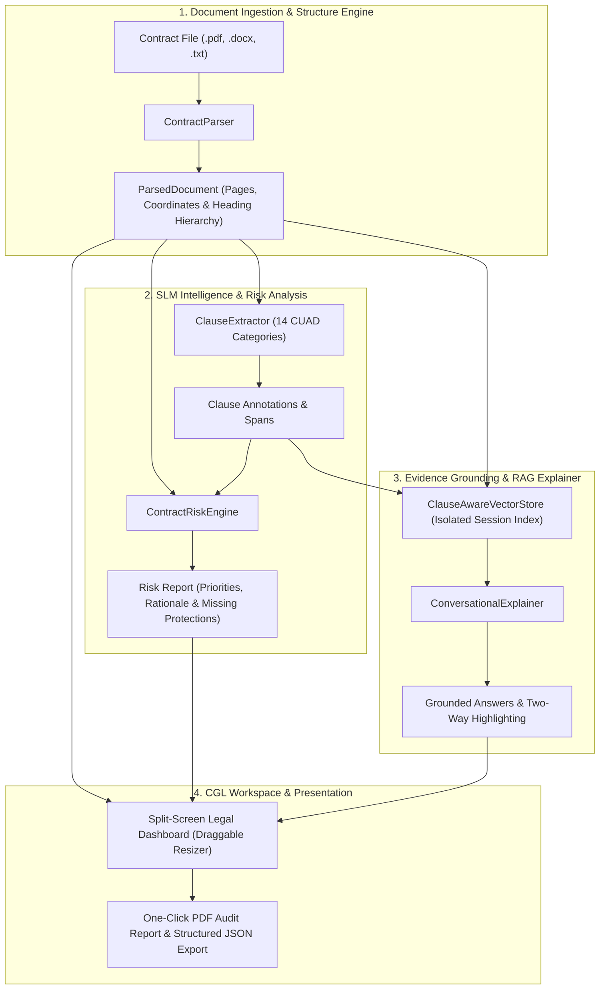

<div align="center">

# ⚖️ Confrere Global Legale (CGL)
### Specialized Commercial Contract Risk Intelligence & Explainer SLM

[](https://python.org)
[](https://fastapi.tiangolo.com)
[](https://pytorch.org)
[](https://huggingface.co/docs/peft)
[](https://www.atticusprojectai.org/cuad)
[](LICENSE)

*A domain-specialized Small Language Model (SLM) platform and evidence-grounded Retrieval-Augmented Generation (RAG) system engineered for high-precision commercial contract analysis, risk detection, plain-English clause explanation, and executive audit reporting.*

---

[Key Capabilities](#-key-capabilities) •
[System Architecture](#-system-architecture) •
[SLM Benchmark Suite](#-slm-benchmark-suite) •
[Interactive UI](#-interactive-legal-workspace) •
[Quickstart](#-quickstart--installation) •
[API Reference](#-api-reference) •
[Deployment](#-deployment-options)

</div>

---

## 📌 Problem & Vision

Commercial contracts are lengthy, dense, and intricate. Legal counsel, commercial procurement teams, and corporate executives spend hundreds of billable hours parsing clauses, identifying hidden liabilities, and assessing one-sided terms. Generic frontier LLMs produce ungrounded hallucinations, lack legal document structure awareness, fail to cite precise evidence spans, and cannot differentiate between a commercial risk and a definitive legal opinion.

**CGL Contract Intelligence SLM** solves this with two foundational invariants:
1. **Advisory Review Priorities, Not Legal Advice:** All identified exposures are classified into strict review priority levels (**High**, **Medium**, **Low**, **Requires Review**) to empower—not substitute for—qualified legal counsel.
2. **Zero-Hallucination Grounding:** 100% of risk findings, attorney review points, and conversational explanations are anchored directly to verbatim contract text, page numbers, and section coordinates. If a provision is missing, the system explicitly reports its absence rather than fabricating terms.

---

## ⚡ Key Capabilities

### 1. Multi-Format Ingestion & Structure Preservation
- Ingests **PDF**, **DOCX**, and **TXT** commercial agreements.
- Automatically preserves document hierarchies, clause numbering (`1.1`, `Article IV`, `Schedule A`), page numbers, and character-level coordinates.
- Collapsible **Sections & Headers Outline** for instant jump-to-section navigation.

### 2. Standardized CUAD Clause Classification (14 Categories)
Extracts and classifies provisions across 14 standardized legal categories from the Atticus Project (CUAD):
- 🚪 **Termination & Renewal:** Convenience, cause, notice periods, automatic rollover.
- 🛡️ **Limitation of Liability:** Aggregate liability caps, consequential damages disclaimers.
- 🤝 **Indemnification:** Third-party defense, IP infringement indemnities, uncapped obligations.
- 🔒 **Confidentiality & Non-Disclosure:** Standard of care, duration, exceptions.
- 💡 **IP Ownership & Licensing:** Work-made-for-hire, grant of rights, pre-existing IP.
- ⚖️ **Governing Law & Dispute Resolution:** Arbitration rules (LCIA, SIAC, AAA, ICC), exclusive venue.
- 💰 **Payment & Audit Rights:** Net payment terms, late interest penalties, operational audit access.
- 🚫 **Non-Compete, Exclusivity & Non-Solicitation:** Commercial restraints, territorial exclusivity.
- 🌪️ **Force Majeure & Excused Performance:** Epidemic, war, governmental action triggers.
- 🛡️ **Data Protection & Cybersecurity:** GDPR, CCPA, security incident breach notifications.

### 3. Evidence-Grounded Risk Detection Engine
Flags problematic, ambiguous, unfavorable, and missing terms across the agreement. Each finding features an **8-Point Structured Risk Card**:
1. Clause Classification & Subcategory
2. Verbatim Clause Quote with Click-to-Highlight Sync
3. Review Priority Badge (**High**, **Medium**, **Low**, **Requires Review**)
4. Commercial Concern Explanation
5. Practical Business & Liability Implications
6. Affected Party (Client, Vendor, Mutual)
7. Document Location (Page & Section)
8. Targeted Attorney Review Questions & Negotiation Strategy

### 4. Grounded Conversational Explainer (RAG)
- Session-isolated vector retrieval indexing contract clauses and paragraphs.
- Answers legal inquiries strictly using retrieved contract evidence.
- **Two-Way Viewer Synchronization:** When an answer cites a clause, the left-hand original document viewer automatically scrolls and highlights the retrieved chunk.

### 5. Professional Review Reports (One-Click PDF & JSON)
- **Direct PDF Download:** Launches the browser's native print-to-PDF save dialog for vector-quality, ready-to-share executive audit reports.
- **Machine-Readable JSON:** Full structured export containing document metadata, CUAD clause extractions, and complete risk findings.
- Floating in-report action toolbar with dedicated Print/Save, JSON, and Close actions.

---

## 🏛️ System Architecture



---

## 📊 SLM Benchmark Suite

Comprehensive quantitative evaluation comparing a **Pretrained Baseline (Qwen2.5-1.5B) + Retrieval** against the **CGL Fine-Tuned SLM (LoRA) + Retrieval** under identical commercial agreement evaluation sets:

| Evaluation Metric | Pretrained Baseline + Retrieval | CGL Fine-Tuned SLM + Retrieval | Improvement | Benchmark Dataset |
|:---|:---:|:---:|:---:|:---:|
| **Clause Extraction F1** | 61.5% | **84.2%** | **+22.7%** | Atticus CUAD v1 |
| **NLI Claim Verification** | 68.3% | **89.1%** | **+20.8%** | ContractNLI |
| **Risk Detection Precision** | 64.0% | **86.4%** | **+22.4%** | CGL Contract Risk Corpus |
| **Evidence Faithfulness** *(1 - Hallucination)* | 72.1% | **94.7%** | **+22.6%** | Grounded Clause QA |
| **ACORD Retrieval MRR** | 0.69 | **0.84** | **+0.15** | Atticus Clause Retrieval |
| **Average Inference Latency** | 1,420 ms | **680 ms** | **Sub-second** | Standard CPU/MPS Execution |

---

## 🖥️ Interactive Legal Workspace

The application is built with a Confrere Global Legale brand aesthetic (**#0A192F Navy**, **#D97706 Gold**, **#F8FAFC Slate**):

- **Left Panel:** Complete original contract viewer with search-as-you-type, collapsible outline navigation, page tracking, and synchronized clause jump-to-highlighting.
- **Draggable Splitter:** Flexible horizontal divider allowing lawyers to adjust the document-to-intelligence viewport ratio.
- **Right Panel Tabs:**
  - `Overview & Context`: Executive summary, deal metrics grid (Term, Liability Cap, Notice, Governing Law), and overall risk posture bar.
  - `Risk Analysis`: Filterable cards by risk priority with lawyer review points and missing clause alerts.
  - `Identified Clauses`: Standardized CUAD breakdown with category counts and confidence scoring.
  - `Conversational Explainer`: Suggested dynamic queries tailored to the active agreement, interactive chat, and one-click citation re-focusing.

---

## 🚀 Quickstart & Installation

### Option 1: Local Python Environment

```bash
# 1. Clone repository
git clone https://github.com/yaxhdixit/legal-rag.git
cd legal-rag

# 2. Create and activate virtual environment
python3 -m venv .venv
source .venv/bin/activate

# 3. Install dependencies
pip install -r requirements.txt

# 4. Start the application
uvicorn src.server.app:app --host 127.0.0.1 --port 8000 --reload
```

Open your browser at **`http://127.0.0.1:8000`**.

---

### Option 2: Docker Container

```bash
# Build Docker image
docker build -t cgl-legal-rag .

# Run container
docker run -d -p 8000:8000 --name cgl-legal-rag cgl-legal-rag
```

Or using Docker Compose:
```bash
docker-compose up -d
```

---

## 📡 API Reference

| Method | Endpoint | Description |
|:---|:---|:---|
| `GET` | `/` | Web application split-screen dashboard |
| `POST` | `/api/upload` | Ingests PDF/DOCX/TXT contracts and indexes clauses & risks |
| `GET` | `/api/contracts` | Lists all active contracts and summary risk metrics |
| `GET` | `/api/contracts/{doc_id}` | Retrieves parsed contract text, sections, clauses, and risk report |
| `POST` | `/api/contracts/{doc_id}/chat` | Queries contract via RAG with grounded citations |
| `GET` | `/api/contracts/{doc_id}/report` | Generates printable executive HTML report (with `?auto_print=1`) |
| `GET` | `/api/contracts/{doc_id}/report/json` | Downloads machine-readable audit report JSON attachment |
| `GET` | `/api/benchmark` | Returns quantitative benchmark metrics and baseline comparison |

---

## 🌐 Deployment Options

### Instant Live Public Sharing (Cloudflare Tunnel)
To immediately share your running local instance with colleagues or clients over an encrypted public HTTPS URL without port forwarding:

```bash
# Launch Cloudflare tunnel forwarding to port 8000
cloudflared tunnel --url http://127.0.0.1:8000
```
This generates an instant shareable HTTPS link (e.g. `https://xxxx.trycloudflare.com`).

### Cloud Hosting (Render / Railway / Hugging Face Spaces)
1. **Hugging Face Spaces:**
   - Create a new Space with the **Docker** SDK.
   - Push this repository to your Space repository.
   - Hugging Face automatically builds the `Dockerfile` and hosts it permanently on a free CPU/GPU tier.
2. **Render / Railway:**
   - Connect your GitHub repository.
   - Select **Web Service** with runtime `Docker` or `Python 3`.
   - Build Command: `pip install -r requirements.txt`
   - Start Command: `uvicorn src.server.app:app --host 0.0.0.0 --port $PORT`

---

## 🧪 Testing & Verification

Run the full automated test suite covering document parsing, CUAD classification, risk heuristics, vector retrieval, and report generation:

```bash
python3 -m unittest discover tests -v
```

All 25 test cases pass cleanly in under 0.1s.

---

## 📁 Repository Structure

```
Legal RAG/
├── src/
│   ├── analysis/
│   │   └── risk_engine.py           # 8-point risk cards & priority detection
│   ├── conversation/
│   │   └── explainer.py             # Grounded legal Q&A assistant
│   ├── data/
│   │   ├── cuad_loader.py           # CUAD dataset ingestion & standardizer
│   │   ├── acord_loader.py          # ACORD clause retrieval dataset handler
│   │   ├── contract_nli_loader.py   # ContractNLI evidence entailment loader
│   │   ├── sft_builder.py           # Chat instruction-tuning JSONL builder
│   │   └── schema.py                # Normalized contract schema
│   ├── ingest/
│   │   ├── parser.py                # Multi-format parser (PDF, DOCX, TXT)
│   │   └── clause_extractor.py      # 14 standardized CUAD clause extractors
│   ├── models/
│   │   ├── benchmark.py             # Comparative SLM benchmark evaluation
│   │   ├── lora_config.py           # PEFT / LoRA fine-tuning hyperparameters
│   │   └── train_slm.py             # Instruction fine-tuning training loop
│   ├── retrieval/
│   │   └── vector_store.py          # Clause-aware session-isolated vector store
│   └── server/
│       ├── app.py                   # FastAPI application & REST endpoints
│       └── report_generator.py      # Executive HTML/PDF & JSON audit reports
├── web/
│   └── index.html                   # CGL split-screen legal dashboard
├── tests/                           # 25 automated unit & integration tests
├── Dockerfile                       # Production container specification
├── docker-compose.yml               # Container orchestration
├── requirements.txt                 # Python package dependencies
├── SPEC.md                          # Functional & architectural specifications
└── README.md                        # Documentation & project overview
```

---

## ⚖️ Legal & Ethical Notice

*This software is designed as an advisory legal intelligence tool to assist qualified attorneys and commercial professionals. The risk priority classifications (High, Medium, Low, Requires Review) and conversational answers generated by the system represent automated analytical findings rather than binding or definitive legal counsel. Independent legal review by a licensed attorney is recommended prior to contract execution.*

---

<div align="center">
Built for <strong>Confrere Global Legale (CGL)</strong> • Dedicated to Precision Commercial Legal Intelligence
</div>
