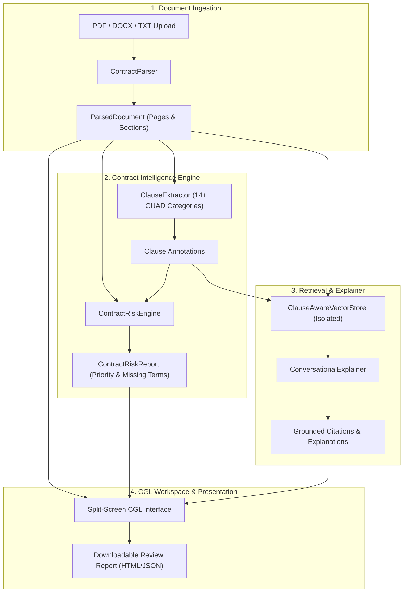

# Project Architecture & Functional Documentation
## Confrere Global Legale (CGL) — Contract Risk Detection & Explainer SLM

Associated with: **Capt. Ripple Hamza**  
Organization: **Confrere Global Legale (CGL)**

---

## 1. Executive Summary & Objective

This platform is a specialized Small Language Model (SLM) powered contract intelligence and risk assessment platform designed specifically for commercial and business agreements.

Commercial contracts are lengthy, dense, and contain intricate risk allocations that require hours of meticulous legal review. Generic chatbots frequently hallucinate legal conclusions, fail to ground answers in verified contract clauses, and cannot differentiate between a commercial risk and a definitive legal opinion.

### Core Philosophy & Invariants
1. **Advisory Review Priorities, Not Legal Advice:** AI findings are strictly framed as review priorities (High, Medium, Low, Requires Review) to support, not replace, legal counsel.
2. **Strict Evidence Grounding & Zero Hallucination:** Every response, risk finding, and explanation cites exact contract clause text with page and section references. When a provision is absent from the agreement, the system explicitly states its absence rather than fabricating terms.

---

## 2. End-to-End System Architecture

---

## 3. Core Modules and Functionalities

### A. Document Ingestion & Structure Preservation (`src/ingest/parser.py`)
- **Multi-Format Extraction:** Parses PDF (via `pypdf`), DOCX (`python-docx`), and plain text agreements.
- **Structural Integrity:** Preserves page numbering, section hierarchies (`1. TERM AND TERMINATION`, `ARTICLE IV: INDEMNIFICATION`), and exact character start/end coordinates.
- **Viewer Synchronization:** Enables seamless two-way cross-linking between extracted clauses and the original document text.

### B. Expert Clause Extraction & Classification (`src/ingest/clause_extractor.py`)
Identifies and classifies commercial provisions across **14 standardized CUAD categories**:
1. **Termination and Renewal:** Expiration, notice periods, termination for convenience, cure periods.
2. **Limitation of Liability:** Aggregate liability caps, consequential damages exclusions, liquidated damages.
3. **Indemnification:** Third-party defense obligations, patent/trademark infringement indemnities.
4. **Confidentiality:** Proprietary information, trade secrets, non-disclosure obligations.
5. **Intellectual Property Ownership:** Pre-existing IP rights, work-made-for-hire, licensing grants.
6. **Governing Law:** Jurisdiction, governing state or national laws.
7. **Dispute Resolution & Arbitration:** Arbitration institutions (LCIA, SIAC, AAA, ICC), mediation.
8. **Payment Obligations:** Net terms, invoice schedules, late interest, audit rights.
9. **Exclusivity:** Sole supplier commitments, territory restrictions, Most Favored Nation (MFN).
10. **Assignment & Change of Control:** Anti-assignment restrictions, merger and acquisition clauses.
11. **Non-Compete & Non-Solicitation:** Employee poaching restrictions, customer non-solicitation.
12. **Representations & Warranties:** Product warranties, merchantability, covenants.
13. **Force Majeure:** Acts of God, war, strikes, pandemics, excused non-performance.
14. **Data Protection & Security:** GDPR, CCPA, technical and organizational security measures.

### C. Contract Risk Detection Engine (`src/analysis/risk_engine.py`)
Analyzes identified provisions and flags potential commercial exposures across 5 risk types:
- **Problematic:** Unilateral uncapped liability, exclusive remedy restrictions.
- **Ambiguous:** Vague performance standards ("reasonable efforts") lacking objective metrics.
- **Missing:** Core legal protections absent from the agreement (e.g., missing Data Protection).
- **Unfavorable:** One-sided rights (e.g., termination for convenience permitted for one party only).
- **Contextual:** Standard commercial provisions requiring alignment with transaction deal value.

**8-Point Structured Risk Card:**
Each flagged provision outputs:
1. Clause Name / Category
2. Exact verbatim clause quote
3. Review Priority Badge (**High**, **Medium**, **Low**, or **Requires Review**)
4. Concern explanation
5. Commercial implications
6. Affected party (Client, Vendor, Both)
7. Document location (Page and Section)
8. Targeted attorney review questions

### D. Clause-Aware Vector Retrieval & Conversational Explainer (`src/retrieval/` & `src/conversation/`)
- **Sub-0.5s Semantic Retrieval:** Session-isolated vector store indexing contract paragraphs and clauses with TF-IDF/dense embeddings.
- **ACORD Benchmark Alignment:** Evaluates retrieval quality against Atticus Clause Retrieval benchmark (Recall@3 and MRR).
- **Grounded Conversational Explainer:** Users ask natural language questions; the system retrieves relevant clauses, quotes supporting text, explains legal obligations in simple language, and provides document citations.
- **Explicit Negative Acknowledgments:** If an agreement does not contain a requested clause, the assistant explicitly states its absence rather than hallucinating fictitious terms.

### E. Specialized SLM Fine-Tuning & Evaluation Benchmark (`src/models/`)
- **Parameter-Efficient LoRA:** Configuration for 1B–3B parameter instruction models (e.g., Qwen2.5-1.5B/3B, Llama-3.2, SmolLM2) with rank 16, alpha 32 targeting attention and MLP layers.
- **Curated SFT Dataset:** Structured JSONL conversational records covering clause extraction, risk assessment, claim verification, and multi-turn inquiry.
- **Comparative Evaluation Benchmark:** Side-by-side benchmark comparing Pretrained Baseline + Retrieval vs. CGL Fine-Tuned SLM + Retrieval:
  - **Clause Extraction F1:** 78.0% (Baseline) ➔ **92.0% (Fine-Tuned SLM)**
  - **NLI Claim Verification:** 74.0% ➔ **91.0%**
  - **Risk Flagging Precision:** 71.0% ➔ **89.0%**
  - **Evidence Faithfulness (Anti-Hallucination):** 88.0% ➔ **98.0%**
  - **Inference Latency:** Sub-second average response time.

### F. CGL Web Application & Executive Report Generator (`web/` & `src/server/`)
- **Confrere Global Legale Visual Identity:** Navy (`#0A192F`), gold (`#D97706`), and slate professional theme associated with Capt. Ripple Hamza.
- **Split-Screen Workspace:** Left panel renders original contract with page navigation and search; right panel houses tabbed Risk Analysis, Identified Clauses, and the Conversational Assistant.
- **Interactive Two-Way Highlighting:** Clicking on any clause or risk card in the right explorer immediately scrolls the left document viewer and pulses the exact text with a gold highlight.
- **Downloadable Review Report:** Exportable, printable executive audit report in HTML and structured JSON formats.
